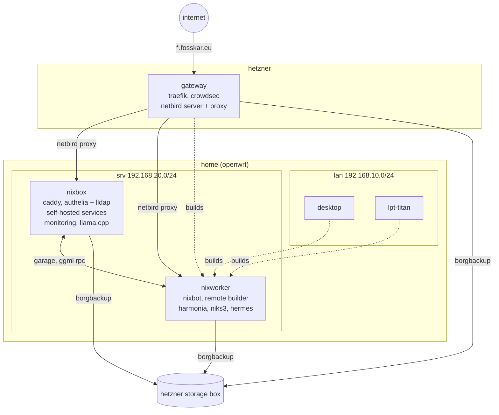

# machines

all machines except nixworker use [preservation](../docs/decisions/state-persistence.md) (ephemeral root, opt-in state persistence).

## configuration model

machine configs are composition edges: feature modules are exposed through `flake.modules.*` and assembled per host through imports and clan inventory.

### secrets and rollback

rollback wipes root on every boot, so the preservation module sets `clan.core.vars.sops.secretUploadDirectory` to `/persist/var/lib/sops-nix`. `clan machines install` and `clan machines update` upload the age key and activation secrets there, and sops reads the key from there, so a machine can be installed with preservation enabled from the start.

---

## topology

all machines join netbird, yggdrasil, and wireguard (controller on gateway); nixbox and nixworker route the home lan for netbird peers. local services are served by caddy on nixbox under `*.nx3.eu`; public exposure is configured in the netbird ui, see [netbird-exposure](../docs/netbird-exposure.md).

---

## networking

### IP allocation scheme

| range       | purpose                                          |
| ----------- | ------------------------------------------------ |
| `.1-.99`    | network infra (router, APs, switches, KVMs)      |
| `.100-.199` | personal devices (workstations, laptops, phones) |
| `.200-.255` | servers                                          |

### static IPs

source of truth: `flake.hosts` in `modules/flake-parts/hosts.nix`. machine
`networking.nix`, the `internet`/`wireguard` inventory instances, and feature
modules all read from it. this table is a derived copy; update `hosts.nix` first.

| machine   | IP               | method                               |
| --------- | ---------------- | ------------------------------------ |
| desktop   | `192.168.10.100` | NixOS static, no DHCP                |
| ha-green  | `192.168.10.50`  | NixOS static, no DHCP                |
| lpt-titan | `192.168.10.150` | NixOS static + DHCP (roaming laptop) |
| nixbox    | `192.168.20.200` | NixOS static, no DHCP                |
| nixworker | `192.168.20.210` | NixOS static, no DHCP                |
| gateway   | `138.201.155.21` | hetzner                              |

servers define their own static IP in `networking.nix` with `useDHCP = false` per interface.
the laptop keeps DHCP enabled so it works on other networks.

---

## desktop

daily driver workstation (ryzen 7 7800x3d, rx 7800xt, 32gb ddr5)

- niri with noctalia-shell and the noctalia greeter
- btrfs root, systemd-boot
- amd gpu with lact, opencl; amd cpu with `amd_pstate`
- steam, gamemode, gamescope
- docker and podman
- yubikey as openpgp ssh key and u2f
- hermes and buzz desktop clients

---

## lpt-titan

framework 13 laptop (ryzen ai 5 340, radeon 840m, 32gb ddr5)

- niri with noctalia-shell and the noctalia greeter
- nixos-hardware `framework-amd-ai-300-series`, fw-fanctrl
- encrypted bcachefs root, secure boot via lanzaboote
- fingerprint auth, usbguard, yubikey u2f and lock on removal
- hermes and buzz desktop clients

---

## nixbox

home server (ryzen 7 5700x, 64gb, nvidia rtx pro 4000 blackwell sff, zfs)

**storage:** zfs root pool plus data pool `tank`. datasets are declared with `nixfiles.zfs.datasets` and use legacy mountpoints, see [zfs](../docs/decisions/zfs.md). `tank/scratch` holds rebuildable data and is excluded from auto snapshots; `tank/reserved` is a never-mounted reservation.

**infrastructure:** caddy for `*.nx3.eu`, postgresql, garage node, ups primary (eaton ellipse pro via nut)

**auth:** authelia (sso, oidc provider) and lldap; [why](../docs/decisions/sso-stack.md)

**monitoring:** victoriametrics, victorialogs, grafana, telegraf, beszel hub, gatus, homepage

**llm & agents:** llama.cpp on the rtx pro 4000, offloading to nixworker over ggml rpc

**media:** jellyfin, seerr, immich, navidrome, audiobookshelf, and the arr stack (prowlarr, sonarr, radarr, lidarr, chaptarr, bazarr, sabnzbd, recyclarr)

**apps:** opencloud with collabora and radicale, vaultwarden, matrix (continuwuity), buzz relay, miniflux, searxng, kiwix, dawarich, protomaps, and smaller tools

**other:** talos vm for kubernetes experiments

**backup:** borgbackup to the hetzner storage box: service state and database dumps, plus zfs snapshots of selected `tank` datasets

---

## nixworker

minisforum ms-a2 (ryzen 9 9955hx, intel arc pro b50, 96gb ddr5), btrfs root without preservation

- nixbot ci; evaluates `.#checks` and runs scheduled effects for update prs
- nix-grpc-store builder; other machines offload builds here
- harmonia and niks3 binary caches, garage node
- ggml rpc server on the arc for the llama.cpp router on nixbox
- radicle mirror
- hermes agents in fencr sandboxes; mcp gateway with calendar, grafana and laya backends
- borgbackup of service state and fencr sandbox checkpoints to the hetzner storage box
- headless dev host: workspace user, `nix-ld`
- ups secondary

---

## gateway

hetzner vps cx23, public edge

- netbird server: management, signal, relay, dashboard, and the proxy for public `*.fosskar.eu` ingress
- traefik with geoblock; crowdsec with traefik and firewall bouncers
- wireguard controller
- borgbackup of `/persist` to the hetzner storage box
- srvos hetzner-cloud preset, sshd reachable only over the overlay networks
